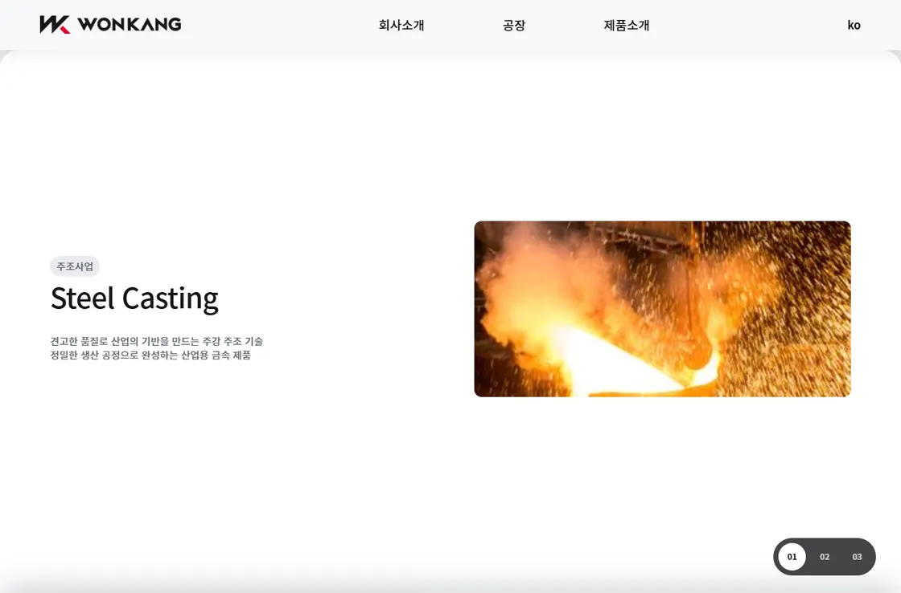
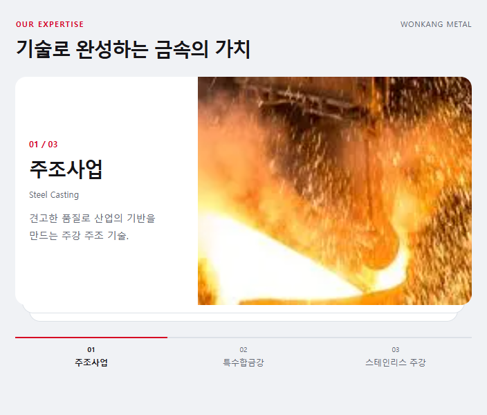
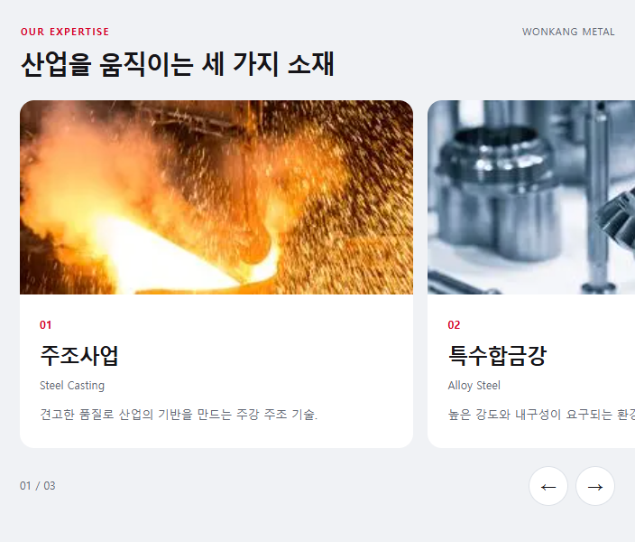
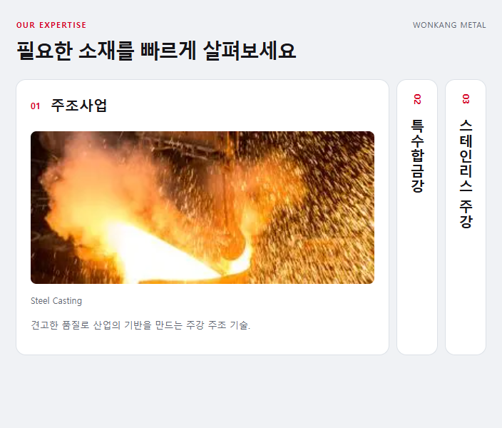
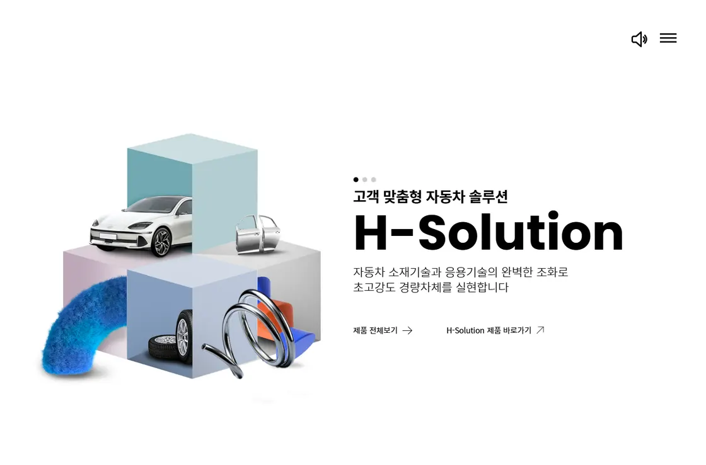

# 원강금속 사업 카드 디자인 비교

2026-10-29 · 디자인 검토와 선택 자료 · 실제 사이트 적용 전

## 먼저 고를 방향

**추천은 A ‘사진형 스택’입니다.** 원래 원했던 카드가 아래에서 올라와 겹치는 움직임을 유지하면서, 사진·글·여백의 비율을 정리하는 방향입니다. 사진 원본 교체를 함께 고려해야 합니다.

| 안 | 이런 느낌을 원할 때 | 좋은 점 | 감수할 점 | 기존 디자인에서 변화 |
| --- | --- | --- | --- | --- |
| **A · 사진형 스택 — 추천** | 기존 의도를 살리면서 완성도를 높이고 싶음 | 산업 사진이 주인공. 모든 카드의 글·사진 위치가 일정함. 기존 겹침 유지 | 세 장을 순서대로 보는 스크롤 길이는 남음. 큰 사진을 위한 원본 교체 필요 | 작음 |
| **B · 가로 슬라이더** | ‘넘기는 카드’임이 분명하고 가볍게 보였으면 함 | 옆 카드가 보여 탐색을 유도. 모바일 스와이프에 자연스러움. 화면 길이를 줄임 | 사용자가 넘기지 않으면 뒤 사업을 놓칠 수 있음. 아래에서 겹치는 움직임은 변경 | 중간 |
| **C · 펼침형 카드** | 사업 분야를 한눈에 파악하고 원하는 것만 보고 싶음 | 세 사업명이 항상 보임. 관심 있는 사업을 바로 선택. 짧은 화면에 정보 집중 | 닫힌 카드의 세로 제목은 취향을 탐. 모바일에서는 세로 아코디언으로 전환 필요 | 중간~큼 |

위 평가는 현재 정보가 세 사업 분야이고, 기존 카드 인터랙션을 유지하려는 요청이 있었다는 점을 기준으로 한 디자인 판단입니다. 사용성 실험으로 산출한 점수는 아닙니다.

## 현재 어색해 보이는 이유

1. **큰 카드에 작은 사진과 짧은 내용이 떠 있습니다.** 각 카드는 거의 한 화면 높이를 사용하지만 사진 높이는 약 278px입니다. 주변 공간에 비해 중심이 약해 큰 섹션처럼 느껴집니다.
2. **사진 원본이 작습니다.** `service-casting.png`, `service-alloy.png`, `service-stainless.png` 모두 350×141px입니다. 현재 PC 표시 크기부터 확대가 발생하며, 사진을 더 크게 배치하면 선명도 문제가 더 드러납니다.
3. **읽는 위치가 카드마다 바뀝니다.** 첫 번째는 글→사진, 두 번째는 사진→글, 세 번째는 다시 글→사진입니다. 겹치는 모션과 좌우 반전이 함께 작동해 시선이 계속 이동합니다.
4. **제목의 우선순위와 탐색 표시가 약합니다.** 한국어 사업명은 작은 태그이고 영어 제목이 가장 큽니다. 하단의 01·02·03은 각 카드의 내용을 알려주지 못합니다.
5. **흰색·회색·파란색의 큰 면적 변화가 강합니다.** 카드가 전환될 때 사업 정보보다 화면 전체의 색상 변화가 먼저 들어옵니다. 세 분야를 묶는 공통성이 약해 보일 수 있습니다.

## A · 사진형 스택

실제 움직임 참고: [SketchzLab — Sticky stacking cards](https://sketchzlab-cloneable-7.webflow.io/)

참고할 점은 일정한 카드 폭, 다음 카드가 보이는 겹침, 뒤 카드의 미세한 축소로 드러내는 깊이입니다. 예시의 배경이나 문구를 그대로 옮기는 안은 아닙니다.

원강금속에 적용할 구성:

- PC에서는 좌우 바깥 여백을 두고 카드 높이를 약 520~640px 범위에서 내용에 맞춥니다. 이는 제안 범위이며 확정 치수는 아닙니다.
- 사진 약 60%, 글 약 40%. 세 장 모두 글은 왼쪽, 사진은 오른쪽으로 통일합니다.
- 큰 한국어 사업명 → 작은 영문명 → 짧은 설명 순서로 읽히게 합니다.
- 큰 면적의 배경색은 통일하고 빨간 진행선·작은 포인트로 브랜드를 표현합니다.
- ‘01 주조사업 / 02 특수합금강 / 03 스테인리스 주강’으로 이동 대상을 표시합니다.
- 다음 카드의 가장자리가 조금 보이게 하여 세 장의 관계를 보여줍니다.
- 모바일에서는 사진 위·글 아래로 통일합니다. 화면 높이가 작거나 모션 감소를 선택한 경우 읽기 쉬운 일반 흐름으로 보여줍니다.

아래 이미지는 원강금속의 현재 사진으로 만든 구성 비교안입니다. 최종 사진의 선명도를 나타내는 완성 시안은 아닙니다. 대화 안의 비교에서는 사업명 버튼으로 카드 내용을 바꿔볼 수 있으며, 실제 페이지의 스크롤 모션은 적용 단계에서 맞춥니다.

## B · 가로 슬라이더

실제 사이트 참고: [Apple Mac — 라인업 살펴보기](https://www.apple.com/kr/mac/)

참고할 점은 일정한 사진 영역과 제목 위치, 오른쪽에 남겨 보이는 다음 카드, 화면 아래의 명확한 이전·다음 버튼입니다. 제품 판매 요소와 Apple의 색상·스타일은 가져오지 않습니다.

원강금속에 적용할 구성:

- PC에서는 카드 여러 장과 다음 카드 일부를 함께 보여줍니다.
- 큰 사진 아래에 한국어 사업명·영문명·한두 문장 설명을 정렬합니다.
- 모바일에서는 한 장과 다음 장 일부를 보여주고 스와이프와 버튼을 모두 지원합니다.
- 페이지를 위아래로 스크롤하는 동작은 유지합니다. 세로 휠을 강제로 가로 이동으로 바꾸지 않습니다.

**가장 분명한 장점은 ‘더 넘길 내용이 있다’는 사실을 바로 보여준다는 점입니다.** 다만 기존의 아래에서 겹치는 연출을 바꾸는 선택입니다.

## C · 펼침형 카드

실제 구성 참고: [Relume — Layout 351](https://www.relume.ai/components/layout-351)

공식 구성 미리보기의 한 패널을 넓히고 나머지 패널을 좁게 남기는 배치를 참고합니다. 원강금속 비교안의 클릭 전환과 모바일 배치는 이 구조를 응용한 제안입니다.

원강금속에 적용할 구성:

- 세 사업명을 항상 표시하고 선택한 카드에서만 사진·설명을 펼칩니다.
- 여러 화면을 연속해서 스크롤하지 않고 원하는 분야로 바로 갈 수 있습니다.
- PC에서는 가로 펼침, 모바일에서는 제목이 가로로 읽히는 세로 아코디언으로 전환합니다.

**사업 정보를 찾기에는 효율적이며, 기존 스크롤 연출보다 차분한 인상입니다.** 닫힌 카드의 세로 제목을 읽는 방식과 전체 디자인 변화 폭을 보고 선택하면 됩니다.

## 사진과 글을 다듬을 때 참고할 산업 사이트

[현대제철 — H-Solution 브랜드 소개 영역](https://www.hyundai-steel.com/product-tech-home)

큰 산업 비주얼, 짧은 설명, 분명한 제목으로 중심을 만드는 예입니다. 현재 원강금속도 공간 안에서 사진과 핵심 정보가 차지하는 비중을 조정하면 안정감이 좋아질 것으로 판단합니다. 이 링크는 홈페이지 형태로 열리며 아래로 내려 H-Solution 영역을 확인할 수 있습니다.

## 선택 기준과 사진 조건

- **원래 카드 느낌을 살리고 싶으면 A.** 추천 조합은 겹치는 움직임 + 사업명이 보이는 이동 버튼입니다.
- **가볍고 익숙한 슬라이더가 좋으면 B.** 세로 페이지 길이를 줄이는 변화가 큽니다.
- **회사 사업 정보를 빠르게 찾아보게 하려면 C.** 세 사업명을 항상 남기는 것이 핵심입니다.

A·B처럼 사진을 크게 쓰려면 현재 350×141px 이미지 대신 고해상도 원본 또는 대체 사진이 필요합니다. PC 표시 폭 600~800px와 고밀도 화면을 고려하면, 긴 변 1600px 정도의 원본 확보를 제안합니다. 이는 제안 기준이며 기존 파일을 단순 확대해 선명도를 높일 수 있다는 뜻은 아닙니다.

비교안은 같은 기존 사진과 같은 세 사업 내용을 사용했습니다. 버튼과 카드 전환은 비교를 돕기 위한 동작입니다. 실제 제품 페이지와 문의 기능을 새로 구현한 결과는 아닙니다.

검증: 비교안의 320·736·1024px 화면에서 카드 선택·이전/다음·펼침, 이미지 로드와 가로 넘침을 확인했습니다. 운영 중인 메인페이지의 HTML·CSS·JavaScript는 이 검토 작업에서 변경하지 않았습니다.

출처 확인과 직접 화면 확인일: 2026-10-29. 외부 사이트의 디자인은 이후 변경될 수 있습니다.
