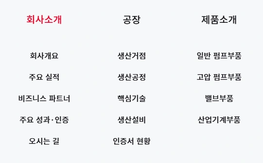
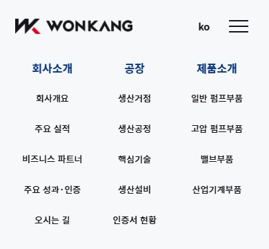

# HTML 구조 평가와 내비게이션 정리

2026-10-29 · 사용자 요청 반영

## 평가

기존 코드는 `header / main / section / article / footer`의 기본 뼈대와 버튼·링크 구분은 적절했습니다. 다만 여러 번 수정한 흔적이 남아 있어, 현업에서 계속 유지보수할 코드로 보기에는 정리가 부족했습니다.

가장 큰 문제는 주 메뉴와 하위 메뉴가 서로 다른 DOM 영역과 배치 규칙을 사용했다는 점입니다. 위 메뉴는 flex와 gap, 아래 메뉴는 별도 grid와 백분율 margin으로 배치되어 화면 폭이 바뀌면 기준점이 달라졌습니다. 들여쓰기만 고쳐서는 해결되지 않는 구조 문제였습니다.

## 실제 수정

| 항목 | 수정 내용 |
| --- | --- |
| 내비게이션 관계 | 하나의 nav 안에서 각 li가 주 메뉴 버튼과 자신의 하위 ul을 함께 포함 |
| 가로 정렬 | 세 메뉴 그룹이 같은 3열 grid를 사용하고, 주 메뉴와 하위 링크를 같은 열 중심에 정렬 |
| 접근성 연결 | 각 버튼의 aria-controls가 해당 하위 목록의 고유 ID를 가리키도록 연결 |
| 메뉴 조작 | 데스크톱 hover·Enter·아래 방향키·Escape, 모바일 열기·그룹 접기·섹션 이동 지원 |
| 제목 구조 | 주요 구역 h2 아래의 사업·제품 이름을 h3로 정리 |
| 불필요한 구조 | 실제 sticky 범위인 card-stack__deck은 유지하고 역할이 없던 card-stack__sticky만 제거 |
| 불필요한 인라인 값 | 사용하지 않는 사진 순서 값 8개와 이미지 너비 변수 12개 제거 |
| 클래스명 | 실제 좌우 교차 목록에 맞춰 process-gallery__columns를 process-gallery__items로 정리 |
| 코드 형식 | HTML·CSS·JS를 4칸 들여쓰기와 일관된 줄바꿈으로 정리하고 .prettierrc.json 추가 |

메뉴의 핵심 구조는 다음과 같습니다.

```html
<nav aria-label="주 메뉴">
    <ul class="site-nav__list">
        <li class="site-nav__group">
            <button aria-controls="submenu-company">회사소개</button>
            <ul id="submenu-company">
                <li><a href="#company">회사개요</a></li>
            </ul>
        </li>
        <!-- 공장·제품소개도 같은 구조 -->
    </ul>
</nav>
```

사진·폰트·공통 reset·Swiper를 재사용했으며, 실행용 프레임워크나 라이브러리는 추가하지 않았습니다.

## 검증

- 360·390·768·851·1024·1440·1920px에서 주 메뉴와 하위 메뉴의 열 중심 차이 **0px**.
- 중복 ID, 누락된 aria-controls 대상, 중첩된 버튼·링크 0개.
- 키보드 Enter로 열기, 아래 방향키로 하위 링크 이동, Escape로 닫고 버튼에 포커스 복귀 확인.
- 모바일에서 그룹 접기·펼치기와 하위 메뉴 선택 후 닫힘 확인.
- 기존 스크롤 카드, CTA 호버, 제품 상세, 갤러리 등장, 인증서 확대 검사 통과.
- 6개 화면 폭에서 이미지 누락·페이지 가로 넘침·JS 오류 검사 통과.
- Prettier 구문 분석·형식 검사와 Node JS 구문 검사 통과.

[내비게이션 검증 기록](navigation-verification.json) · [전체 기능 검사](verification.json) · [인터랙션 검사](interaction-verification.json)

## 정리한 메뉴 화면




