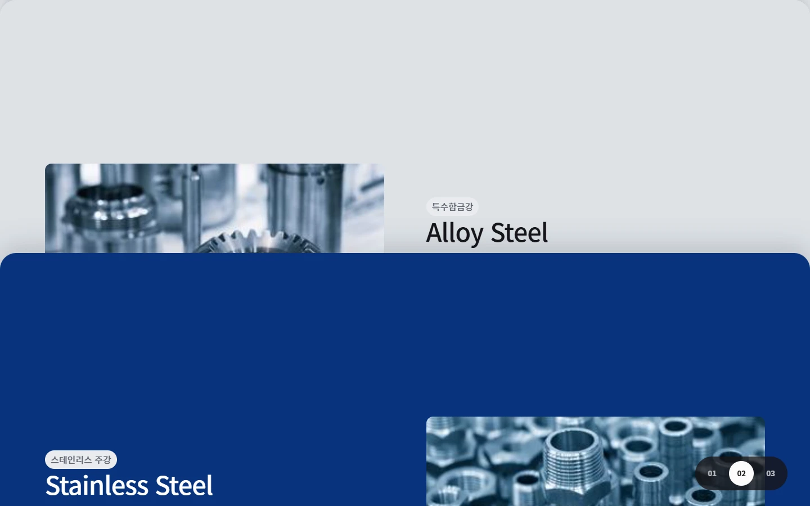
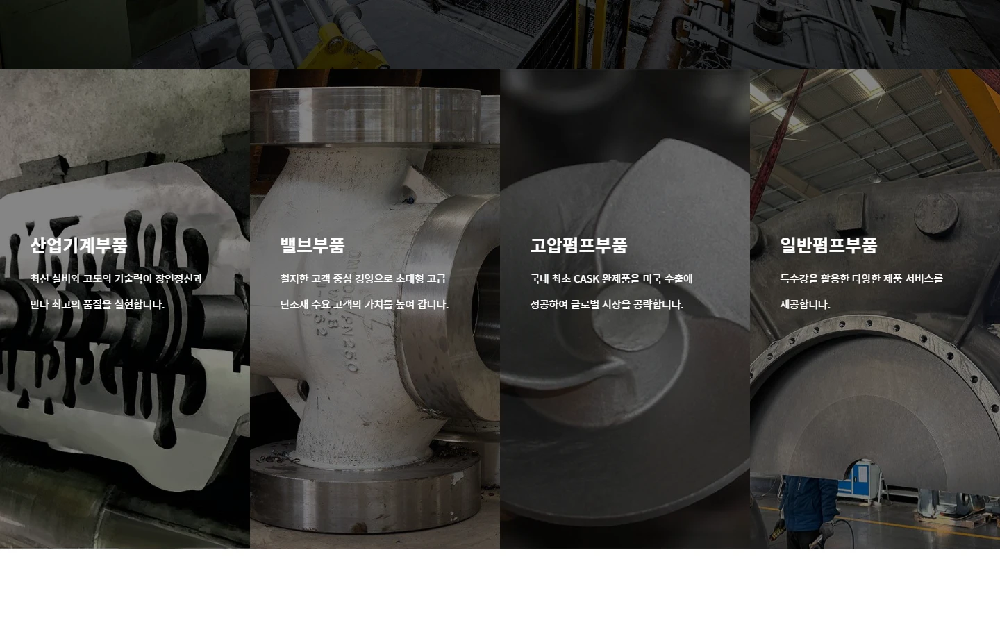
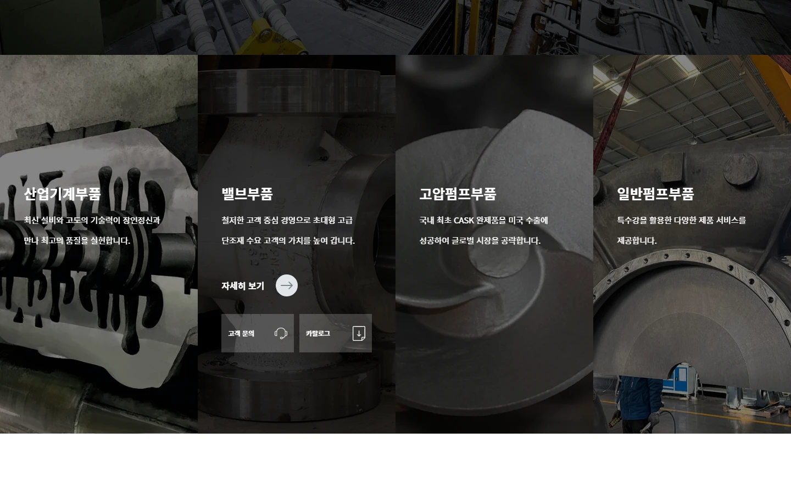
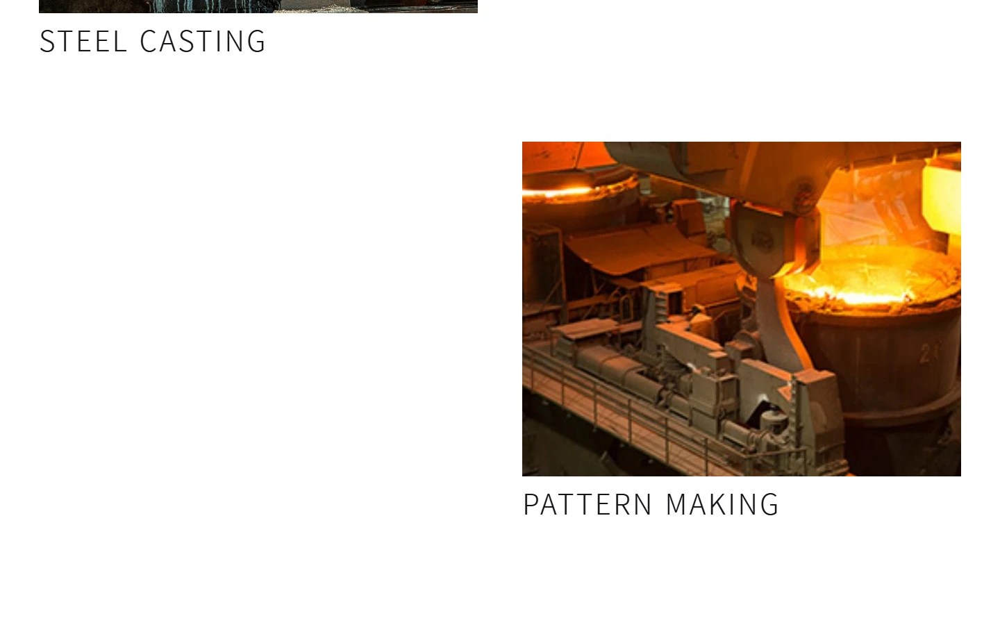
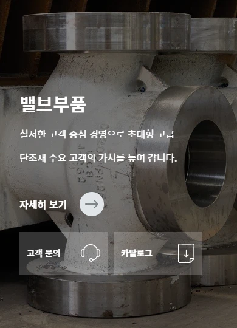

# 원강금속 인터랙션 수정 결과

2026-10-29 · 사용자 추가 요청 반영

## 바뀐 동작

1. **사업 소개 슬라이더:** 흰색·회색·파란색 카드가 스크롤하면서 아래에서 올라와 순서대로 겹칩니다. `01 / 02 / 03` 버튼으로 앞뒤 카드에 바로 이동할 수 있습니다.
2. **제품 CTA:** 네 제품 모두 마우스를 올리면 ‘자세히 보기 / 고객 문의 / 카탈로그’가 나타납니다. 마우스가 나가면 접히며, 키보드로 제품 영역에 포커스해도 펼쳐집니다. 터치 화면에서는 버튼을 바로 표시합니다.
3. **긴 생산·기술 구역:** 사진 8개를 실제 콘텐츠 순서대로 좌·우 교차 배치하고 같은 세로 간격을 적용했습니다. 스크롤해 들어오면 아래에서 위로 미끄러지며 나타납니다.

스크롤을 멈추면 사진은 원래 위치에 정착합니다. 모션 감소 설정에서는 사진과 내용을 고정 표시합니다. 피그마 사진·SVG는 기존 원본을 그대로 재사용했습니다.

## 확인 결과

- 실제 스크롤 좌표와 화면 최상단 요소를 검사해 카드 고정·겹침을 확인했습니다.
- 카드 번호 버튼으로 마지막 카드와 첫 카드 사이를 이동하는 동작을 확인했습니다.
- CTA 4개 모두 호버 전 숨김 → 호버 시 버튼 3개 표시 → 마우스가 나가면 숨김을 확인했습니다.
- 키보드 포커스로 펼치고 Tab으로 상세 버튼에 이동하는 동작을 확인했습니다.
- 갤러리의 초기 아래쪽 위치에서 최종 위치까지 이동하는 애니메이션을 확인했습니다.
- 1440px 화면에서 사진 사이 간격 7개가 모두 120px로 일치했습니다. 1920px에서는 160px, 모바일에서는 64px입니다.
- 터치 환경에서 호버 없이 카탈로그 안내를 열고 닫았습니다.
- 360·390·768·1024·1440·1920px 이미지·레이아웃·기존 기능 검사도 통과했습니다.

[인터랙션 검증 기록](interaction-verification.json) · [전체 기능 검증](verification.json)

## 화면 예시

### 스크롤 카드 겹침

### CTA 호버 전

### CTA 호버 후

### 좌우 교차와 일정한 간격

### 터치 화면

