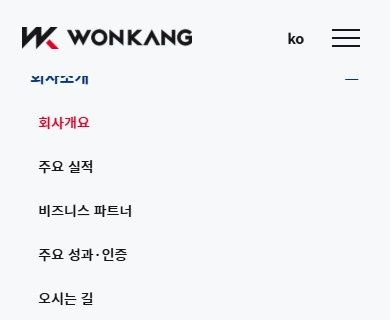
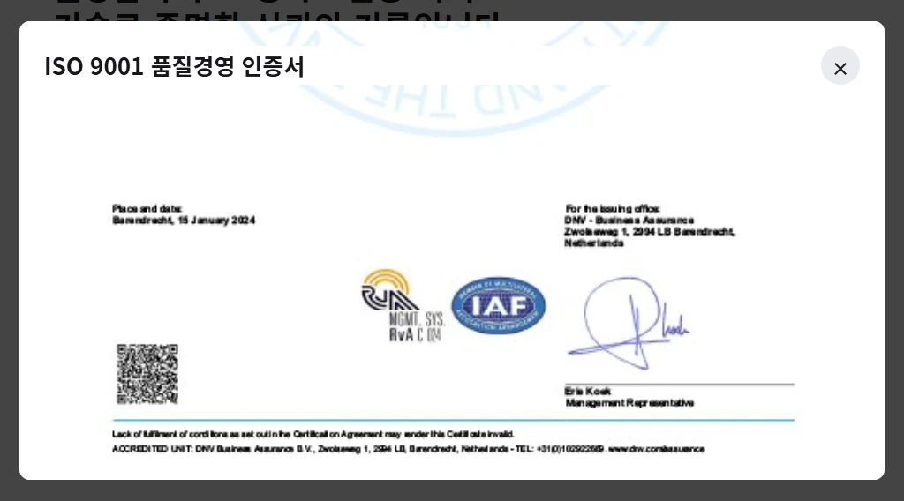

# 반응형·주요 기능 점검 결과

2026-10-29 · 간단한 오류 수정, 사용자 결정에 따라 미제작 메뉴는 임시 경로만 연결

## 수정 완료

| 문제 | 재현과 수정 |
| --- | --- |
| 스크롤 방향에 따른 헤더 표시 | 아래로 스크롤하면 숨고 위로 스크롤하면 다시 표시. 화면 상단의 메뉴 한 줄 높이와 여유 16px 안에 마우스가 들어와도 표시. 메뉴 펼침·키보드 조작 중에는 유지. 히어로 경계의 밝은 배경 전환은 유지 |
| 주 메뉴를 클릭하면 바로 닫힘 | 호버가 먼저 열고 같은 클릭이 다시 닫는 충돌을 확인. 마우스 클릭은 열린 상태를 유지하고 키보드 Enter는 기존 열기·닫기를 유지 |
| 클릭한 메뉴가 커서를 빼도 열린 채 남음 | 마우스 클릭으로 남은 포커스까지 메뉴 유지 조건으로 처리하던 오류 수정. 커서가 헤더를 벗어나면 닫고, 키보드로 조작 중인 포커스만 유지 |
| 작은 창에서 메뉴 끝 항목을 쓰기 어려움 | 메뉴를 화면 높이 안으로 제한하고 내부 스크롤 지원. 600px 이하에서는 세로 접기·펼치기로 전환 |
| 창 크기를 바꾼 뒤 메뉴 상태 | 850px와 600px 경계에서 상태·키보드 접근 제한을 함께 초기화. 1440 → 850 → 600 → 320 → 601 → 851 → 1440px 연속 조작 확인 |
| 좁은 헤더의 로고와 버튼 공간 | 로고가 남은 공간 안에서 줄어들도록 최대 너비를 제한해 메뉴 버튼을 덮지 않도록 처리 |
| 인증서 확대 후 닫기 버튼 소실 | 실제 큰 이미지를 읽은 뒤 스크롤했을 때 닫기 버튼이 화면 위로 사라지는 것을 재현. 팝업 제목·닫기를 상단에 고정 |

## 검증

- 1920·1440·1024·851·768·390·320px에서 아래로 스크롤 시 숨김, 위로 스크롤 시 표시, 상단 마우스 접근 시 표시, 작은 스크롤 흔들림 억제, 키보드 접근과 열린 메뉴 유지 확인. 일반 애니메이션과 모션 감소 설정에서 검사.
- PC 1920·1440·1024·851px에서 세 주 메뉴를 각각 클릭한 뒤 커서를 빼면 하위 메뉴가 닫히고, 히어로 안에서는 투명 배경으로 복귀. 키보드 조작과 히어로 경계 배경 전환도 확인.
- 히어로 경계 2px 전·경계 도달·경계 통과·역방향 스크롤에서 배경 전환 시점을 확인. 7개 화면 크기와 모바일 높이 변경에서도 실제 히어로 높이를 기준으로 전환.
- 메뉴는 화면 상단에 고정된 채 나타나고 숨으며, 페이지 레이아웃과 기존 카드 높이를 밀어내지 않음. 맨 위로 돌아오면 투명 배경의 헤더 표시.
- 하위 메뉴 이동 후 대상 영역이 헤더에 가리지 않으며, 로고를 누르면 메뉴를 닫고 맨 위의 투명 헤더로 복귀.
- 320×568, 390×240, 600×360, 601×320, 768×360, 850×320, 851×320, 900×240, 1024×568, 1440×900에서 마지막 하위 메뉴 항목이 화면 안에 나타나고 클릭됨.
- 메뉴를 스크롤해도 뒤 페이지 위치는 이동하지 않음.
- 작은 메뉴 버튼을 다른 요소가 덮지 않는지 실제 클릭 위치로 검사.
- 인증서 팝업을 끝까지 스크롤한 뒤에도 닫기 버튼이 화면 안에 남고 클릭됨.
- 기존 내비게이션 구조·키보드 검사, 이미지·레이아웃 검사, 카드·CTA·갤러리 인터랙션 검사 통과.

[반응형 검증 기록](responsive-verification.json)

[스크롤 방향·마우스·키보드 헤더 검증 기록](header-visibility-verification.json)

GitHub Pages 배포 후에도 같은 창 크기·연속 크기 변경·팝업 닫기 검사를 통과했습니다. [공개 사이트 검증 기록](responsive-live-verification.json)에서 확인할 수 있습니다.

## 임시 경로 확정 · 상세 구현 보류

### CI 소개·생산거점의 전용 내용 없음

최초 점검에서는 ‘CI 소개’가 푸터의 로고 위치로, ‘생산거점’이 생산공정과 같은 갤러리로 연결되어 있었습니다.

사용자 결정: 메뉴 이름을 유지하고 임시 경로만 만듭니다. 현재 제작 범위 밖인 상세 화면·콘텐츠·기능은 구현하지 않습니다.

| 메뉴 | 임시 경로 | 현재 상태 |
| --- | --- | --- |
| CI 소개 | `company/ci.html` | 준비 중 안내와 메인 복귀 링크만 제공 |
| 생산거점 | `factory/locations.html` | 준비 중 안내와 메인 복귀 링크만 제공 |

카탈로그 원본과 정식 개인정보 취급방침은 기존과 같이 실제 자료 제공 후 연결해야 합니다.

## 수정 화면

